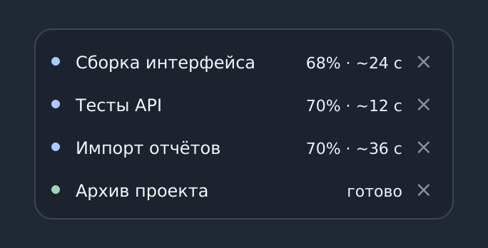

# Process HUD

**Небольшая панель для фоновых задач на Linux.**

Запустили долгие тесты, сборку проекта или импорт данных — и можно переключиться на другую работу. Process HUD оставит запущенную через него команду работать в фоне, а в полупрозрачном окне поверх остальных покажет, что с ней происходит. По нажатию на задачу открываются подробности и логи.



*Реальный интерфейс программы с демонстрационными задачами.*

## Что умеет

- Запускать команды в фоне и показывать, выполняются они, завершились успешно или с ошибкой.
- Отображать прогресс и примерное оставшееся время, **если сама задача передаёт эти данные**. HUD не выдумывает проценты по времени работы.
- Показывать логи, уведомлять о завершении и при желании воспроизводить звук.
- Подключаться к уже работающим процессам и контейнерам Docker. Есть также поддержка Kubernetes Job и удалённых задач по SSH — эти варианты пока не проверены в реальном окружении.

Панель занимает немного места, подстраивается под количество задач и может работать на нескольких мониторах. Строку можно убрать крестиком, а затем вернуть через **Ctrl+Z** в том же сеансе панели.

**Важно:** убрать строку — не значит остановить процесс. Process HUD наблюдает за работой, но не управляет её остановкой или перезапуском.

## Установка

Пока поддерживается **Linux**. Интерфейс проверен на Ubuntu 24.04 с GNOME/X11. Нужны Python 3.10+, модуль `venv` (на Ubuntu — пакет `python3-venv`) и доступ в интернет для установки зависимостей.

```bash
git clone https://github.com/ViskyG/process-hud.git
cd process-hud
bash install.sh
```

Установщик размещает программу в домашнем каталоге, добавляет команду `process-hud` и skill для Codex. Он не включает автозапуск и не запускает фоновые задачи без вашего действия.

Откройте панель:

```bash
~/.local/bin/process-hud ui show
```

А теперь запустите небольшую демонстрационную задачу:

```bash
~/.local/bin/process-hud run --title "Демонстрация" -- \
  ~/.local/share/process-hud/venv/bin/python \
  ~/.local/share/process-hud/examples/demo.py
```

Она появится в панели с настоящим прогрессом. После завершения можно открыть её строку и посмотреть результат. Команда запуска сразу возвращает идентификатор задачи — ждать её окончания в терминале не нужно.

Если `process-hud` уже доступен в `PATH`, полный путь `~/.local/bin/process-hud` можно не писать.

## Повседневное использование

Например, чтобы запустить тесты своего проекта:

```bash
process-hud run --title "Тесты" --cwd /путь/к/проекту -- python3 -m pytest
```

Здесь нужно подставить настоящий путь к проекту и подходящий Python. Для просмотра задач и результата из терминала есть команды:

```bash
process-hud list --text
process-hud report ID
```

`ID` — идентификатор, который HUD выдаёт при запуске. В GNOME установщик может добавить сочетание **Ctrl+Alt+H** для открытия панели, если оно не занято. Панель можно скрыть клавишей **Escape**; работающие задачи от этого не остановятся.

[Другие команды и примеры →](docs/USAGE.md)

## Если вы работаете с Codex

Process HUD полезен и без ИИ. Но если вы используете **Codex**, установленный вместе с программой skill подсказывает агенту, когда стоит передать наблюдение за долгой командой HUD вместо постоянных проверок статуса.

Можно попросить Codex:

> Для долгих неинтерактивных команд используй $process-hud. Проверяй итоговый результат, а обработанные задачи убирай из панели.

Есть и дополнительная возможность: **экспериментальная интеграция с Codex в VS Code**. С ней агент может получить событие о завершении задачи и продолжить работу в исходном диалоге. Пока задача выполняется, обычная локальная программа следит за ней без обращений к модели. Когда Codex возвращается к работе, токены расходуются как обычно.

Интеграция включается **отдельно**, после основной установки, из папки репозитория:

```bash
~/.local/share/process-hud/venv/bin/python scripts/install_codex_bridge.py
```

После этого нужно перезагрузить окно VS Code. Установка меняет настройку расширения Codex, предварительно сохраняя резервную копию. Этот режим рассчитан на стандартную установку VS Code с Codex на **Linux x86_64** и пока не является универсальной интеграцией для всех клиентов.

[Подключение, ограничения и отключение интеграции →](docs/CODEX_BRIDGE.md)

## Что стоит знать

Это ранняя версия проекта. Основные сценарии проверены на Ubuntu с GNOME/X11, включая локальные процессы, Docker и возврат результата в Codex. Работа с настоящими Kubernetes Job и удалёнными задачами через SSH пока не проверена; Windows, macOS и полноценная работа поверх окон в Wayland не поддерживаются.

Process HUD не обещает, что запущенная задача переживёт выход пользователя из системы или перезагрузку компьютера. Если процесс пропал или связь оборвалась, программа не выдаёт неизвестный результат за успешное завершение и не запускает работу повторно сама.

[Что именно проверено →](docs/VALIDATION.md)

## Документация

[Подробное использование](docs/USAGE.md) · [Интеграция с Codex](docs/CODEX_BRIDGE.md) · [Архитектура](docs/ARCHITECTURE.md) · [Исследования](docs/RESEARCH.md) · [Участие в разработке](CONTRIBUTING.md)
